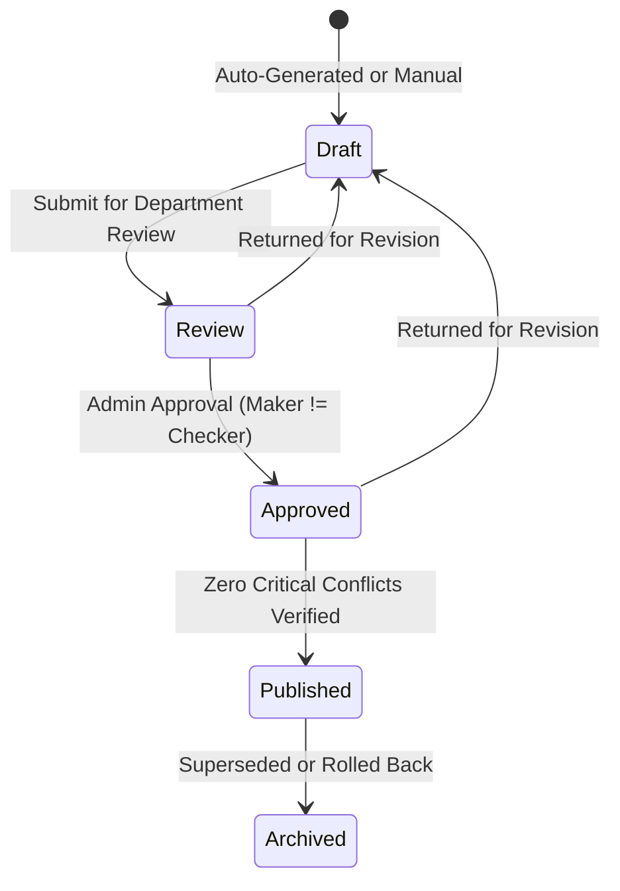

# P13 Architecture: Auto-Scheduler Engine, Explainable Conflicts & Approval Workflow

## 1. Executive Summary & Context
In educational institutions running Djadwal, manual timetable generation is resource-intensive and prone to human errors. Previously, conflict detection was merely a reactive notification after insertion, with manual overrides allowing accidental collisions.

The **P13 Architecture** elevates Djadwal with:
1. **A Dual-Engine Constraint Solver**: Combining instant heuristic search (MRV + Degree + LCV) with deep constraint optimization (local search / simulated annealing).
2. **Explainable Human-Readable Conflicts**: Detecting collisions across professors, rooms, student groups, capacity, room equipment, and institutional pauses (e.g. Friday prayer, lunch) with plain Arabic explanations and **exactly 3 single-click actionable resolutions**.
3. **Immutable Schedule Versions & Audit Trail**: Every proposed schedule is encapsulated inside `schedule_versions` without ever touching the published production schedule directly.
4. **Strict Dual Approval Workflow (Four-Eyes Principle)**: State transitions (`draft` => `review` => `approved` => `published`) strictly enforce `created_by !== approved_by`.
5. **Publishing Conflict Guard**: Blocks publishing if any unresolved critical collision remains.
6. **Sub-10-Second Instant Rollback**: Atomic restoration of any previous approved version.
7. **Change Impact Simulator**: Pre-calculates exact affected counts and percentages for professors, rooms, and groups before applying changes.

---

## 2. Solver Architecture: Dual Engine

```
+-------------------------------------------------------------------------+
|                        SCHEDULING INPUTS                                |
|  - Tasks (Course, Group, Prof, Duration, Room Requirements)             |
|  - Constraints (Grid, Unavailability, Capacities, Institutional Blocks) |
+-------------------------------------------------------------------------+
                                   |
                                   v
+-------------------------------------------------------------------------+
|                  ENGINE 1: FAST HEURISTIC SOLVER                        |
|  - Variable Ordering: Minimum Remaining Values (MRV) + Degree Heuristic |
|  - Value Ordering: Least Constraining Value (LCV) + Room Fit            |
|  - Execution Time: Milliseconds to single-digit seconds                 |
|  - Output: Initial complete candidate assignment                       |
+-------------------------------------------------------------------------+
                                   |
                  (If conflicts exist or optimizing soft constraints)
                                   v
+-------------------------------------------------------------------------+
|               ENGINE 2: CONSTRAINT OPTIMIZATION SOLVER                  |
|  - Neighborhood Search & Min-Conflicts Mutation                         |
|  - Metropolis Acceptance with Simulated Annealing Cooling               |
|  - Deterministic Seed (Mulberry32 PRNG) for Reproducibility             |
|  - Strict Timeout Enforcement (Default 30s, benchmark slice <= 180s)   |
|  - Output: Best Found Schedule + Comprehensive Explanations             |
+-------------------------------------------------------------------------+
```

---

## 3. Explainable Conflict Model & 3 Actionable Resolutions

Every collision is parsed into a structured, user-friendly format:
- `id`: Unique conflict identifier.
- `type`: `PROFESSOR_OVERLAP`, `ROOM_OVERLAP`, `GROUP_OVERLAP`, `CAPACITY_EXCEEDED`, `ROOM_TYPE_MISMATCH`, `WORKLOAD_EXCEEDED`, `PROFESSOR_UNAVAILABLE`, `INSTITUTIONAL_BLOCK`.
- `severity`:
  - `CRITICAL`: Hard collisions that strictly prevent publishing.
  - `MAJOR`: Capacity or room equipment shortages.
  - `MINOR`: Soft gaps and workload preferences.
- `explanationArabic`: Natural Arabic sentence explaining who, when, and where.
- `suggestedResolutions`: **Exactly 3 actionable alternatives**:
  1. `MOVE_SLOT`: Move session to an available conflict-free time slot.
  2. `CHANGE_ROOM` / `CHANGE_PROFESSOR`: Reassign to an available suitable room or qualified professor.
  3. `SWAP_SLOT`: Swap time slots with another session in the week.

---

## 4. Version Lifecycle & Dual Approval (Governance)



### Four-Eyes Principle Enforcement:
```ts
if (Number(version.created_by) === Number(actorId)) {
  throw new ScheduleApprovalError(
    "الموافقة المزدوجة إلزامية: لا يجوز لصانع المسودة اعتمادها أو نشرها بنفسه",
    "DUAL_APPROVAL_VIOLATION"
  );
}
```

### Zero Critical Conflict Gate:
```ts
if (version.critical_conflicts_count > 0) {
  throw new ScheduleApprovalError(
    "يُمنع نشر الجدول لوجود تعارضات حرجة غير مُعالجة",
    "CRITICAL_CONFLICTS_BLOCK_PUBLISH"
  );
}
```

---

## 5. Database Schema & Migration (Additive Only)

### `schedule_versions`
- `id` (serial primary key)
- `semester_id` (integer)
- `version_number` (integer)
- `title` (text)
- `status` (`draft` | `review` | `approved` | `published` | `archived`)
- `note` (text)
- `created_by` (integer)
- `approved_by` (integer, nullable)
- `approved_at` (timestamp, nullable)
- `published_at` (timestamp, nullable)
- `metrics` (text JSON)
- `critical_conflicts_count` (integer)
- `total_sessions_count` (integer)
- `created_at` (timestamp)
- `updated_at` (timestamp)

### `schedule_version_items`
- `id` (serial primary key)
- `schedule_version_id` (integer references schedule_versions.id)
- `assignment_id` (integer nullable)
- `course_id`, `professor_id`, `group_id`, `room_id` (integers)
- `day_of_week` (integer 0..6)
- `start_time`, `end_time` (text "HH:MM")
- `session_type` (text)
- `item_status` (`proposed` | `accepted` | `rejected` | `modified`)
- `note`, `metadata` (text)
- `created_at` (timestamp)

---

## 6. Performance & Scale Benchmark
- **Scale**: 300 student groups, 120 professors, 60 rooms.
- **Duration**: ≤ 3 minutes (180,000 ms).
- **Critical Conflicts**: 0.
- **Determinism**: 100% identical output when providing identical seeds.
